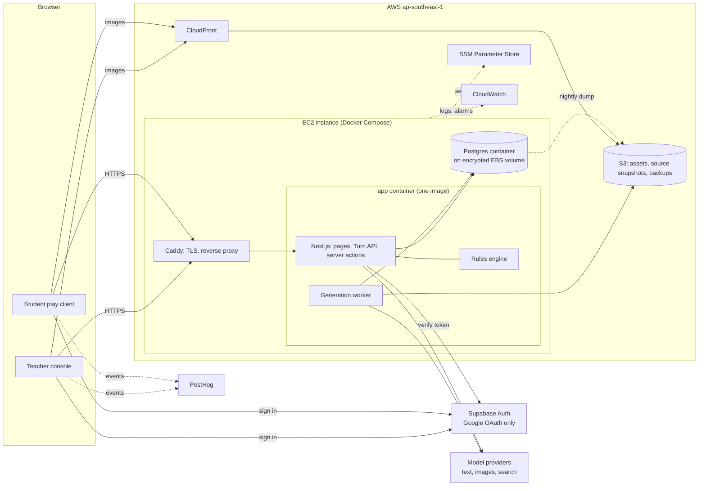

# PRD v3

Status: levels 0–6 agreed and frozen for team review; level 7 (systems and architecture) drafted for team review; level 8 (build plan) to come. The rationale
for each requirement, the team decisions and the open items are in [`PRD-v3-rationale.md`](PRD-v3-rationale.md).
Derived views (overview, glossary, diagrams, example playthrough, v2 vs v3) are in [`prd-v3/`](prd-v3/).

## Purpose

A teacher's materials set the focus; the game draws on the wider historical record to fill in everything a
convincing situation needs. Students step into it: they question the people involved, weigh evidence that
disagrees, and make choices where no option satisfies everyone and not everything can be known. As they play,
the world pushes back and their predictions are put to the test. At the end they give their own account of what
happened and why, then see how it compares with what actually happened and how differently it has been
understood. Students see their own thinking played back, and the teacher gets a picture of the class's thinking
to discuss, without anyone being graded.

## Learning outcomes

### Student
1. **Understand the episode** (primary): who was involved, what each wanted and feared, the key conflicts and
   risks, and what happened and why.
2. **Critical thinking** (skills the game develops):
   - **Question claims:** who says this, why, and how do they know? This includes reading primary text closely.
   - **Cross-check:** compare accounts and documents before trusting them.
   - **Consider other perspectives:** of the people at the time, and of people who have read it differently
     since.
   - **Reason about consequences:** if X, then what?
   - **Weigh and reach a judgement:** prioritise factors and defend a view with evidence.

Understanding the episode wins any trade-off with the skills.

When each skill is practised:

| When | Student does | Skills |
|---|---|---|
| During a stage | Talks, reads, compares | Question claims, consider other perspectives, cross-check |
| End of a stage | Acts at the defining moment, and predicts what happens next | Weigh and reach a judgement, reason about consequences |
| Start of the next stage (or the reveal, for a one-stage adventure) | Sees the consequences of their choice and prediction | Reason about consequences |
| End of the game | The Interview: defends a verdict with evidence against push-back | Weigh and reach a judgement, drawing on all of the above |

### Teacher (provisional, still open)
- **TO1:** gets a ready-to-run activity from their materials with little preparation.
- **TO2:** can trust it: sees what is documented and what is invented, and can correct it before students play.
- **TO3:** gets a picture of the class's thinking to run a discussion.
- **TO4:** keeps control: focus, timer, their own questions.

### Not outcomes
- Connecting the past to the present (left to the teacher).
- Reflection on how the student's own view changed.
- Exam practice during play.
- Grading or ranking.
- Training historians.

## Pillars

1. **Understanding first.** Every student leaves understanding the episode.
2. **Low floor, high ceiling.** Everyone reaches understanding; skilful play earns more, never marks.
3. **Characters are people, not encyclopaedias.** They have stakes, blind spots, agendas and a voice.
4. **The world pushes back.** What the student says and does changes things, not just the final choice.
5. **Hard choices, not a hard clock.** The pressure comes from trade-offs and incomplete information, not time.
6. **The record stays apart from the simulation, without breaking immersion.**
7. **Investigation takes real thought.** Finding people and documents is the start; understanding what they mean
   is the work.

## Product Backlog

### 1. Functional Requirements

| Status | ID | Requirement | Priority | Planned Week |
|---|---|---|---|---|
| | **G** | **Generation** | | |
| ☐ | G1 | The system should generate an adventure focused on the teacher's materials. | | |
| ☐ | G1.1 | The system should draw on sources beyond the teacher's materials for people, setting, context and primary material. | | |
| ☐ | G1.2 | The system should label all content with its source: the specific document's name where known (for example "Utusan Melayu, 12 August 1964"); otherwise its provenance (for example "from the teacher"); or "invented". | | |
| ☐ | G1.2.1 | The system should treat any fact without a citation as invented. | | |
| ☐ | G2 | The system should generate one or more stages, with the number set by the episode. | | |
| ☐ | G2.1 | The system should carry the student's choices forward into later stages. | | |
| ☐ | G2.2 | The system should prefer 1–2 stages for a 45-minute session, and use 3 only for simple stages. | | |
| ☐ | G3 | The system should give the student a role with an identity (who they are, their relationships, their reputation). | | |
| ☐ | G3.1 | The system should give the role personal stakes: something to win or lose. | | |
| ☐ | G3.2 | The system should give the student a private brief: goals, fears, constraints, and what they know at that moment. | | |
| ☐ | G3.3 | The system should give the role reasons why each character will or won't talk to them. | | |
| ☐ | G3.4 | The system should give the role decisions that genuinely change things. | | |
| ☐ | G3.5 | (Tentative, team to confirm) The system should make the role a fictional go-between trusted to different degrees by several sides. | | |
| ☐ | G3.6 | (Tentative, team to confirm) The system should give every student in a class the same role. | | |
| ☐ | G4 | The system should generate 3–5 character-specific stances for each major character (for example guarded, wary, alarmed, confiding). | | |
| ☐ | G4.1 | The system should generate triggers for each major character: a student action, the stance change it causes, and what that change unlocks or closes. | | |
| ☐ | G4.2 | The system should generate a portrait expression for each stance of each major character. | | |
| ☐ | G4.3 | The system should include a trust trigger for every major character: repeated challenged claims lower their stance (P8.4). | | |
| ☐ | G5 | The system should generate discoveries for each character, each with a reveal condition (prior discoveries and/or a stance), grounded as set out in G13. | | |
| ☐ | G5.1 | The system should generate open questions linked to the discoveries that answer them. | | |
| ☐ | G5.2 | The system should generate a central question for each stage. | | |
| ☐ | G5.3 | The system should mark the discoveries in each stage that are core to understanding the episode, drawing them only from major characters or documents. | | |
| ☐ | G6 | The system should generate 3–4 outcomes for each defining moment, with rules that map the student's act, characters' stances and what each character knows to one outcome. | | |
| ☐ | G6.1 | The system should allow hidden outcomes that only skilful play can reach (secret endings). | | |
| ☐ | G6.1.1 | The system should generate at most one secret ending per adventure, at the final defining moment: a plausible path history didn't take, cited where possible. | | |
| ☐ | G6.1.2 | The system should generate 2–3 unlock conditions for the secret ending from: a key figure at their hidden top stance, a guarded non-core discovery found, a slant confronted with a contradicting document, or the right note passed to the right person. | | |
| ☐ | G6.2 | The system should generate an Interview question and interviewer for each ending, fitting that ending. | | |
| ☐ | G6.3 | The system should generate, for each earlier-stage outcome, the endings it closes. | | |
| ☐ | G6.4 | The system should generate endings for the final stage: 1 historical, 2–3 alternatives and 0–1 secret, with no "good" or "bad" labels. | | |
| ☐ | G6.5 | The system should generate 3 verdicts for each Interview question. | | |
| ☐ | G6.6 | The system should generate, for each verdict, the discoveries and documents that cut against it, plus one general counter-argument. | | |
| ☐ | G7 | The system should generate a persona for each major character: voice and real phrases from their documented words, what they knew at that moment, what they want from the student, and what they slant or withhold. | | |
| ☐ | G8 | The system should generate 2–4 major characters per stage, each with a full persona, stances, triggers and several discoveries. | | |
| ☐ | G8.1 | The system should generate 1–3 minor characters per stage, each with a light persona and 1–2 discoveries, and no stances. | | |
| ☐ | G9 | The system should generate written character behaviour: summons and movements, each tied to a story event. | | |
| ☐ | G10 | The system should generate a mix of document kinds per stage (newspapers, letters, telegrams, speeches, minutes, memoir extracts). | | |
| ☐ | G10.1 | The system should use real excerpts wherever a source exists, and invent documents only to fill gaps. | | |
| ☐ | G10.2 | The system should include at least one slanted, incomplete or later-contradicted document per stage. | | |
| ☐ | G10.3 | The system should mark the key passages in each document. | | |
| ☐ | G10.4 | The system should generate written slants for major and minor characters, each catchable through a document or another character's account where history provides one; contradicting evidence is cited, never invented. | | |
| ☐ | G11 | The system should generate 2–4 story events per stage, each with a trigger and an effect from a fixed list. | | |
| ☐ | G12 | The system should generate an adventure in passes: sources, then a skeleton, then stage details and character personas (in parallel), then endings, then the reveal, then checks. | | |
| ☐ | G12.1 | The system should check the skeleton's consistency (for example, reachable endings) before generating details. | | |
| ☐ | G12.2 | The system should repair only the parts that fail a check, not regenerate the whole adventure. | | |
| ☐ | G12.3 | The system should put every structural decision in the skeleton: the role (name, position, relationships, stakes, short brief); characters (name, real or fictional, major or minor, public position, private agenda); stages (title, time and place, central question, rooms, who is present); core discoveries per stage with their holder; defining moments (scene, deciding figure, acts, outcomes); the ending map; endings (type, summary, citations); and a short arc. | | |
| ☐ | G12.4 | The system should check the skeleton automatically: the historical ending is reachable from the start, at least two endings stay reachable at the final defining moment, every stage has a core discovery, and every core discovery is held by a major character or a document. | | |
| ☐ | G13 | The system should cite every core discovery (teacher's materials or another source); core discoveries are never invented. | | |
| ☐ | G13.1 | The system should cite other discoveries where possible, and otherwise label them invented. | | |
| ☐ | G13.2 | The system should quote documents marked as real word for word from their source. | | |
| ☐ | G13.3 | The system should cite the real phrases used in character personas. | | |
| ☐ | G13.4 | The system should cite the historical ending, what actually happened, and differing interpretations. | | |
| ☐ | G13.5 | The system should check every quotation word for word against its source text, for both uploaded and outside sources. | | |
| ☐ | G13.6 | When the teacher's materials and an outside source disagree, the system should follow the teacher's materials and show the conflict to the teacher at review. | | |
| ☐ | G13.7 | The system should use outside sources only from an allowlist by default (for example national archives, the National Library Board, Roots.sg, university and museum sites, encyclopaedias). | | |
| ☐ | G14 | The system should use frontier models with medium–high reasoning for the skeleton, and frontier models with medium reasoning for endings, the Interview and the reveal. | | |
| ☐ | G14.1 | The system should use mid-tier models with search tools and low reasoning to find and extract sources. | | |
| ☐ | G14.2 | The system should use frontier or strong mid-tier models with medium reasoning for stage details and personas. | | |
| ☐ | G14.3 | The system should choose exact models through evaluations. | | |
| ☐ | G15 | After the detail passes, the system should check that: every trigger, angle and counter-point refers to things that exist; every core discovery can be reached within its stage without secret-ending conditions; every reveal condition can be met; every open question and key passage links to a discovery; every slant used in a trigger or unlock is catchable and its contradicting evidence is cited; every slant is corrected in the reveal; the secret ending needs at least two met conditions; every combination of act and situation leads to an outcome; every citation is verified; and every item has a source label. | | |
| ☐ | G16 | The system should let the teacher choose Sec or JC when creating an adventure. | | |
| ☐ | G16.1 | The system should keep real excerpts word for word, but shorter for Sec (about 150 words) than for JC (about 300), with an optional glossary of hard words. | | |
| ☐ | G16.2 | The system should write all other text (dialogue, notes, hints, epilogue, Interview, reveal) to the chosen level, keeping each character's voice. | | |
| ☐ | G17 | The system should generate 5–8 discoveries per stage, 2–3 of them core. | | |
| ☐ | G17.1 | The system should generate 3–5 documents per stage, each with 1–2 key passages. | | |
| | **P** | **Play** | | |
| ☐ | P1 | The system should allow the teacher to turn the stage timer on or off and set its length. | | |
| ☐ | P1.1 | The system should let the student end a stage by acting at its defining moment. | | |
| ☐ | P1.2 | When the timer runs out, the system should bring the defining moment to the student (a final call) instead of skipping their choice. | | |
| ☐ | P1.3 | The system should require the teacher to set the timer when creating an adventure. | | |
| ☐ | P1.4 | The system should default the timer to on, with the whole session (stages, epilogue, Interview and reveal) fitting into 45 minutes. | | |
| ☐ | P1.5 | The system should default to about 2 minutes of briefing, 30 minutes of stages in total, 1 minute of epilogue, 4 minutes of Interview and 6 minutes of reveal. | | |
| ☐ | P2 | The system should let characters challenge claims the student makes. | | |
| ☐ | P2.1 | The system should change the situation when the student shows evidence to a relevant character. | | |
| ☐ | P3 | The system should ask the student for a prediction at the end of each stage. | | |
| ☐ | P3.1 | The system should reveal how each prediction turned out later in the game. | | |
| ☐ | P3.2 | The system should ask the student to predict what the real figure will decide because of their act. | | |
| ☐ | P3.3 | The system should offer the defining moment's written outcomes, rephrased as predictions, as one-tap choices, never listing secret or already-closed outcomes. | | |
| ☐ | P3.4 | The system should reveal the prediction when the next stage opens, or in the epilogue for the last stage. | | |
| ☐ | P3.5 | The system should explain why the outcome happened, using the rule that produced it. | | |
| ☐ | P3.6 | The system should never score predictions or show anyone a student's prediction accuracy. | | |
| ☐ | P4 | The system should show a document's provenance in a form that fits its period (for example, masthead and date, or sender and recipient). | | |
| ☐ | P4.1 | The system should mark real documents subtly and let the student view their source on request. | | |
| ☐ | P4.2 | The system should not show citations in character dialogue. | | |
| ☐ | P5 | The system should give gradually more specific hints when the student is stuck. | | |
| ☐ | P5.1 | The system should treat a student as stuck when they make no progress (no new note or stance change) for a set time. | | |
| ☐ | P5.1.1 | With a stage timer, the system should set the stuck time to half of (time left ÷ core discoveries left), between 45 seconds and 3 minutes. | | |
| ☐ | P5.1.2 | Without a stage timer, the system should set the stuck time to 2 minutes. | | |
| ☐ | P5.1.3 | The system should pause the stuck clock while the student is reading a document or waiting for a reply. | | |
| ☐ | P5.1.4 | The system should not use message counts to detect being stuck. | | |
| ☐ | P5.2 | The system should start with an open question as the first hint, give more specific angles after that, and end with a story event. | | |
| ☐ | P5.2.1 | The system should let angle hints point to a person to ask, a document or passage to read, a note to pass on, or a document to show. | | |
| ☐ | P5.3 | The system should never complete progress on the student's behalf through a hint. | | |
| ☐ | P5.4 | The system should steer hints towards core discoveries first. | | |
| ☐ | P5.5 | The system should give hints automatically only, with no button to request them. | | |
| ☐ | P5.6 | The system should show hints as the role's own thoughts in the chat. | | |
| ☐ | P5.7 | The system should wait for the student to be stuck again before each further hint step. | | |
| ☐ | P6 | The system should change a character's stance only through its generated triggers. | | |
| ☐ | P6.1 | The system should let a character's stance shape what they reveal, how they treat the student, and which options are available. | | |
| ☐ | P6.2 | The system should let a character express each stance freely in their own voice. | | |
| ☐ | P6.3 | The system should show the character's portrait in the conversation, with an expression that reflects their current stance. (Placement to be decided.) | | |
| ☐ | P6.4 | The system should show a short, subtle notice in the story when a character's stance changes. | | |
| ☐ | P6.5 | The system should not show stance names to the student. | | |
| ☐ | P7 | The system should show the stage's central question at all times. | | |
| ☐ | P7.1 | The system should let a character reveal only discoveries whose conditions are met. | | |
| ☐ | P7.2 | The system should record a discovery as a note in the role's voice when a character conveys it. | | |
| ☐ | P7.3 | The system should not show discoveries or open questions as game objects; open questions appear only as hints. | | |
| ☐ | P8 | The system should let the student insert one of their notes into a chat message through a tool in the message box. | | |
| ☐ | P8.1 | The system should count information as passed on only when it is inserted from the student's notes. | | |
| ☐ | P8.2 | When the student asserts something they haven't discovered, whether helpful or harmful, the character should question how they know it and prompt them to find out properly. | | |
| ☐ | P8.2.1 | The system should challenge only assertions of undiscovered facts, not questions. | | |
| ☐ | P8.3 | The system should never create notes, unlock content, fire triggers or change outcomes from information the student hasn't discovered, including made-up claims. | | |
| ☐ | P8.4 | The system should lower a major character's stance by one after the student makes two claims to them that get challenged. | | |
| ☐ | P8.5 | The system should treat notes from documents and notes from conversations the same everywhere: passing on, triggers and Interview evidence. | | |
| ☐ | P9 | The system should build each stage to a defining moment where a real figure decides based on what the student advises, conveys or keeps back. | | |
| ☐ | P9.1 | The system should offer 2–4 written go-between acts at the defining moment, phrased in the role's voice. | | |
| ☐ | P9.2 | The system should make the historical outcome reachable from the start of the adventure, and offer an act leading to it at each defining moment while it is still reachable, without labelling it. Earlier choices may close it. | | |
| ☐ | P9.3 | The system should determine the outcome of a defining moment from its rules, without randomness. | | |
| ☐ | P9.4 | The system should vary minor details of how an outcome plays out, never the outcome itself. | | |
| ☐ | P9.5 | The system should let the student start the defining moment when ready; when the timer runs out, a story event brings it to them. | | |
| ☐ | P9.6 | If core discoveries are missing when the student starts the defining moment, a character should nudge them without blocking. | | |
| ☐ | P9.7 | The system should have the characters present react immediately to the student's act, before the prediction and consequences. | | |
| ☐ | P9.8 | The system should not branch earlier stages into separate stages; an earlier outcome changes the next stage's situation (stances, who is present, documents, events, opening narration). | | |
| ☐ | P9.9 | The system should let each earlier-stage outcome close specific endings, making them unreachable later. | | |
| ☐ | P9.10 | The system should keep at least two endings reachable at the final defining moment. | | |
| ☐ | P9.11 | The system should show a hidden go-between act leading to the secret ending only when its unlock conditions are met. | | |
| ☐ | P9.12 | The system should never point hints towards the secret ending. | | |
| ☐ | P9.13 | The system should allow written deception acts at a defining moment (for example, "exaggerate the Tunku's hostility"), with written consequences, where the episode suits it. | | |
| ☐ | P10 | The system should let the student pause and resume a session. | Low | |
| ☐ | P11 | The system should give each character a distinctive voice, using real phrases from their documented words where available. | | |
| ☐ | P11.1 | Characters should know only what they could have known at that moment. | | |
| ☐ | P11.2 | Characters should want things from the student and ask for them (favours, messages to carry, secrecy). | | |
| ☐ | P11.3 | Characters should remember what the student told them and how they were treated, across stages. | | |
| ☐ | P11.4 | Characters should hedge and show emotion without contradicting written facts. | | |
| ☐ | P12 | The system should let characters summon the student through story events. | | |
| ☐ | P12.1 | The system should move characters between rooms only through story events. | | |
| ☐ | P12.2 | The system should play written conversations between characters that the student can overhear when in earshot (only if easily viable). | Low | |
| ☐ | P13 | The system should place documents in rooms, have characters hand them over as trigger rewards, or deliver them at story events. | | |
| ☐ | P13.1 | The system should not create a note just because a document was read. | | |
| ☐ | P13.2 | The system should create a note when the student selects a passage that overlaps a key passage. | | |
| ☐ | P13.3 | The system should let hints point to the relevant paragraph of a document. | | |
| ☐ | P13.4 | The system should not label claims or documents as true, false or contradicted during play. | | |
| ☐ | P13.5 | The system should fire a trigger when the student confronts a major character with a document that contradicts their slant. | | |
| ☐ | P13.6 | When the student confronts a minor character with a document that contradicts their slant, the system should unlock a note, without any stance change. | | |
| ☐ | P14 | The system should fire story events on time, on a condition (discovery found, stance reached, document shown, note passed on), when the student is stuck, or when the timer runs out. | | |
| ☐ | P14.1 | The system should limit story event effects to: summons, a character moving, a document delivered, news or an announcement (which may shift stances), and the defining moment beginning. | | |
| ☐ | P14.2 | The system should make a story event fired because the student is stuck create an opportunity (for example, a character seeks them out), never hand over a discovery. | | |
| ☐ | P15 | The system should keep a walkable 2D map with 2–5 rooms per stage. | | |
| ☐ | P15.1 | The system should let the student walk automatically to a named room. | | |
| ☐ | P15.2 | The system should not offer automatic walking to a person or object. | | |
| ☐ | P15.3 | The system should show a minimap of the room layout only, never where characters or documents are. | | |
| ☐ | P16 | The system should flag abusive, hateful or provocative messages. | | |
| ☐ | P17 | The system should run characters on strong mid-tier models with low or no reasoning, optionally frontier for major characters at defining moments. | | |
| ☐ | P17.1 | The system should combine the checks after each exchange (discovery conveyed, assertion or question, abusive) into one cheap model call, run off the chat path. | | |
| ☐ | P17.2 | The system should run the interviewer on a mid-tier model, and narration of minor details on a cheap or mid-tier model. | | |
| ☐ | P18 | The system should open each session with the role briefing: identity, relationships, stakes, private brief and the situation. | | |
| | **E** | **End of game** | | |
| ☐ | E1 | The system should show an epilogue: a short ending scene for the student's run, labelled as their simulation. | | |
| ☐ | E2 | The system should hold the Interview after the epilogue: a short in-chat conversation in which a character asks the student a question that fits their ending. | | |
| ☐ | E2.1 | The system should let the student answer by choosing a verdict. | | |
| ☐ | E2.2 | The system should let the student back the verdict by inserting notes as evidence. | | |
| ☐ | E2.3 | The system should let the student add their own words, optionally. | | |
| ☐ | E2.4 | The interviewer should push back once, using a discovery that cuts the other way or a core discovery the student missed. | | |
| ☐ | E2.4.1 | The system should choose the push-back in this order: a note the student holds that cuts against their verdict, then a missed core discovery, then the general counter-argument. | | |
| ☐ | E2.4.2 | The interviewer should phrase the chosen push-back in their own voice. | | |
| ☐ | E2.5 | The system should let the student respond to the push-back, including changing their verdict. | | |
| ☐ | E2.6 | The interviewer should acknowledge the response and close, with no second push-back and no judgement of the answer. | | |
| ☐ | E3 | The system should show the reveal after the Interview. | | |
| ☐ | E3.1 | The system should show what actually happened. | | |
| ☐ | E3.2 | The system should show how the episode has been interpreted differently. | | |
| ☐ | E3.3 | The system should play back the student's own choices, predictions and Interview answers. | | |
| ☐ | E3.4 | The system should show the source of each piece of content by name (grouped as teacher's materials, other sources and invented), and which parts were the student's own path. | | |
| ☐ | E3.5 | The system should correct anything the student was misled about during play. | | |
| ☐ | E3.6 | The system should show how outcomes could have gone differently. | | |
| ☐ | E3.6.1 | The system should show which earlier choice closed which ending, and where the run split from history. | | |
| ☐ | E3.6.2 | The system should mention in the reveal that a secret path existed, without explaining how to reach it. | | |
| ☐ | E3.7 | The system should cover any core discoveries the student missed. | | |
| ☐ | E3.8 | The system should show by default only what actually happened, the student's path compared with history, and key corrections, with the rest available on request. | | |
| | **T** | **Teacher** | | |
| ☐ | T1 | The system should allow the teacher to add their own end-of-game questions, shown after the reveal (like a take-home or end-of-class question). | | |
| ☐ | T2 | The system should show the teacher a summary of the class's thinking. | | |
| ☐ | T2.1 | The system should show the teacher where students commonly got stuck, as class totals only. | | |
| ☐ | T2.2 | The system should show the teacher how the class's predictions split, never who was right. | | |
| ☐ | T2.3 | The system should show the teacher, as class totals, how Interview verdicts split, how many changed after push-back, and which evidence was used most. | | |
| ☐ | T2.4 | The system should show the teacher which discoveries the class found or missed, per character, as totals. | | |
| ☐ | T2.5 | The system should show the teacher which endings the class reached, as totals. | | |
| ☐ | T2.6 | The system should show the teacher selected Interview answers, anonymised. | | |
| ☐ | T2.7 | The system should organise the class summary into easily navigable sections (for example, tabs) that the teacher can explore freely. | | |
| ☐ | T3 | The system should show the teacher the source label of all content before publishing. | | |
| ☐ | T4 | The system should allow the teacher to reshape the generated adventure extensively, including the number of stages. (Details to be designed.) | | |
| ☐ | T4.1 | The system should regenerate only the parts that depend on a teacher's edit. | | |
| ☐ | T4.2 | The system should give the teacher a review screen to browse by stage, character, document and ending, showing each item's source label and citation, and flagging conflicts. | | |
| ☐ | T4.3 | The system should let the teacher edit everything: the skeleton, personas, discoveries, documents, stances, triggers, story events, hint angles, epilogues, Interview questions and verdicts, the reveal, the timer, the reading level and the allowlist. | | |
| ☐ | T4.4 | The system should offer direct edits (text, and simple forms for rules such as triggers) and plain-language requests that regenerate just that part. | | |
| ☐ | T4.5 | The system should not let real excerpts be rewritten; the teacher can pick another passage, swap the source, or turn it into an invented document labelled as such. | | |
| ☐ | T4.6 | The system should label facts the teacher writes as from the teacher, and show them that way in the reveal's breakdown. | | |
| ☐ | T4.7 | The system should re-run the checks affected by each edit; errors block publishing, warnings don't. | | |
| ☐ | T4.8 | The system should let the teacher play the adventure as a student before publishing. | | |
| ☐ | T4.9 | The system should create a new version when the teacher edits after publishing, keeping students already playing on their original version. | | |
| ☐ | T5 | The system should show the teacher each student's flagged messages, for safeguarding, not grading. | | |
| ☐ | T6 | The system should let the teacher choose a generation mode when creating an adventure: Quick (review at the end), Standard (also pause after the skeleton; the default), or Guided (pause after sources, the skeleton and each detail pass). | | |
| ☐ | T6.1 | The system should run generation in the background, show progress, and notify the teacher when a review is waiting or the adventure is ready. | | |
| ☐ | T6.2 | The system should let the teacher edit any part of the skeleton, add or remove characters, stages, acts and endings, and re-run the skeleton checks after every edit. | | |
| ☐ | T7 | The system should let the teacher add sites to the source allowlist, or allow any credible cited source, for an adventure. | | |

### 2. Constraints

| Status | ID | Requirement | Priority | Planned Week |
|---|---|---|---|---|
| ☐ | C1 | The system should size its default timings so a full session, including the epilogue, Interview and reveal, fits into 45 minutes. | | |
| ☐ | C2 | The system should not present exam-style questions during play. | | |
| ☐ | C3 | The system should support Sec through JC reading levels. | | |
| ☐ | C4 | The system should never grade or rank students. | | |
| ☐ | C5 | The system should limit requests to above human speed, to stop automated abuse. | | |
| ☐ | C6 | The system should end an attempt gracefully when it reaches a ceiling set well above normal use. | | |
| ☐ | C7 | The system should not throttle or hold back characters to save cost during normal play. | | |
| ☐ | C8 | The system should not run free-roaming AI turns for characters between the student's actions. | | |
| ☐ | C9 | Characters should never repeat slurs or hateful statements, and never break character on a student's instruction; they respond with period-appropriate dignity and steer back to the matter at hand. | | |
| ☐ | C10 | The system should treat student messages as untrusted input, never as instructions. | | |
| ☐ | C11 | The system should decide what is true, progress and consequences (which discoveries are available, stances, outcomes, endings) by rules, never by a model. | | |
| ☐ | C12 | The system should not use a model to resolve stages or mint new options during play. | | |

### 3. System requirements

Level 7, draft for team review. The reasoning is in proposals A1–A14 in the rationale.

| Status | ID | Requirement | Priority | Planned Week |
|---|---|---|---|---|
| | **S** | **System** | | |
| ☐ | S1 | The system should run as containers on one EC2 instance in ap-southeast-1 (Singapore): a Postgres container and an app container, behind a TLS proxy. | | |
| ☐ | S1.1 | The system should keep every database file on a separate encrypted EBS volume, so the instance can be replaced without losing data. | | |
| ☐ | S1.2 | The system should store generated images and outside-source snapshots in S3, and store object keys rather than full URLs in the database. | | |
| ☐ | S1.3 | The system should use Supabase only to sign users in (Google OAuth, and email and password for demo accounts), and keep no application data in Supabase. | | |
| ☐ | S2 | The system should verify the sign-in token on the server for every request, and keep its own user table keyed by the Supabase user id. | | |
| ☐ | S2.1 | The system should enforce who may read what in the database (row-level security), not only in the app, so that a missed check in the app fails closed. | | |
| ☐ | S2.2 | The system should never send a student's client anything private: personas, slants, withheld discoveries, triggers, outcome rules or secret-ending conditions. | | |
| ☐ | S3 | The system should run generation (G12) in a server-side worker, independent of any browser tab, running independent passes in parallel. | | |
| ☐ | S3.1 | The system should make every generation pass resumable and safe to retry, so a restart or deploy resumes generation rather than losing it. | | |
| ☐ | S3.2 | The system should notify the teacher in the app when a review is waiting or an adventure is ready, and optionally by email (T6.1). | | |
| ☐ | S3.3 | The system should fetch and store the text of every outside source it cites, so quotations can be checked word for word against the stored text (G13.5) and the teacher can view it at review. | | |
| ☐ | S4 | The system should stream character replies to the student as they are written. | | |
| ☐ | S4.1 | The system should start showing a character's reply within about 2 seconds in normal conditions. | | |
| ☐ | S4.2 | The system should apply the rules (C11) in one database transaction per student action, so two actions can never both use the same state. | | |
| ☐ | S4.3 | The system should run the checks after each exchange (P17.1) after the reply has been sent, and show their results (new notes, stance changes) without the student refreshing. | | |
| ☐ | S5 | The system should handle a class of 40 students playing at once on the single instance. | | |
| ☐ | S6 | The system should back up the database at least daily to S3, keep backups for 30 days, and be restorable to a new instance within an hour. | | |
| ☐ | S6.1 | The system should be deployed from CI, with database migrations applied before the new app starts. | | |
| ☐ | S6.2 | The system should avoid interrupting lessons when deploying: deploys run outside school hours unless urgent. | | |
| ☐ | S7 | The system should keep secrets in AWS (SSM Parameter Store) and give the instance an IAM role, with no long-lived AWS keys on the instance or in the repo. | | |
| ☐ | S7.1 | The system should expose only HTTPS to the internet; the database and admin access are reachable only through AWS Session Manager. | | |
| ☐ | S8 | The system should record token usage per model call and per attempt, so ceilings (C6) and the admin console use the same numbers. | | |
| ☐ | S8.1 | The system should send logs to CloudWatch and alert the team when the app is down, the disk is nearly full, or errors spike. | | |
| ☐ | S9 | The system should store students' data in Singapore, and send it to model providers only under terms that exclude training on it. | | |
| ☐ | S9.1 | The system should let a school or sysadmin delete a student's play data on request. | | |

## System architecture (level 7, draft)

For team review. The decisions and their reasons are proposals A1–A14 in
[`PRD-v3-rationale.md`](PRD-v3-rationale.md#level-7-proposals-for-team-review); the requirements are S1–S9.

### Overview

### Components

| Component | Runs | Responsibility |
|---|---|---|
| Caddy | Container on the instance | TLS certificates (Let's Encrypt), HTTP to HTTPS, proxying to the app, no buffering for streamed replies. |
| Web | App container, Next.js standalone server | Pages, server actions, the Turn API, streamed character replies (S4), the teacher's review screen and class summary. |
| Rules engine | Inside web, a TypeScript package with no I/O | Everything C11 assigns to rules: reveal conditions, triggers and stances, passing on notes, story events, hints, outcomes, closed endings, the Interview push-back choice. Deterministic, so it is tested by replaying attempts. |
| Generation worker | Inside the app container, as a second process from the same image | The generation passes (G12), images (G4.2), post-exchange checks (P17.1), notifications (S3.2). Takes jobs from Postgres. Can move to its own container without code changes. |
| Postgres | Container on the instance, data on its own EBS volume | All application data, row-level security, the job queue, the usage ledger. |
| S3 + CloudFront | AWS | Generated images and outside-source snapshots (private bucket, served through CloudFront), and database backups (separate bucket). |
| Supabase Auth | Supabase (kept) | Google sign-in and demo accounts. Issues the token the app verifies. Holds no application data. |
| Model providers | External | Character replies, checks, interviewer, narration, generation passes, image generation, search for outside sources. |

### Key flows

**Sign-in.** The browser signs in with Supabase Auth as today. On each request the app verifies the token
(signature against Supabase's published keys, expiry and audience) without calling Supabase, then upserts the user
into its own `app_user` table by Supabase user id. Every database call runs in a transaction that sets the current
user, which the row-level security policies read. Background and administrative work uses a separate database role
that bypasses row-level security, as `service_role` does today.

**Generation.** Creating an adventure enqueues a job graph in Postgres: sources, then the skeleton, then stage
details and personas (one job per stage and per character, in parallel), then endings, the reveal, and the checks.
A failing check enqueues a repair job for only the failing part (G12.2). In Standard and Guided modes the graph
stops at a review point until the teacher continues (T6). The worker claims jobs with `FOR UPDATE SKIP LOCKED`,
writes each pass's output before marking it done, and reclaims jobs whose lease expires, so a restart resumes
generation (S3.1). Images (3–5 portraits per major character, G4.2) are separate jobs, cached by prompt hash as today.
The teacher's page shows progress from the job rows.

**Outside sources.** The source pass searches only allowlisted sites by default (G13.7), fetches each page it
uses, and stores the text in S3 with a hash. Citations point at that snapshot, so quotations are checked word for
word against it (G13.5), and the teacher sees exactly what was quoted even if the page later changes.

**A student message.** `POST` to the Turn API → the rules engine decides what the character may reveal and in
which stance (P7.1, P6.1) → the character model streams its reply → the exchange is saved → a check job is
enqueued (P17.1) → when it finishes, the rules engine applies the result (new note, trigger, stance change) in one
transaction (S4.2) → the client receives it through a server-sent event, or on its next state read. Timers keep
using the database clock as today.

**Deploy.** Pushing to `production` builds the image in GitHub Actions, pushes it to ECR, runs migrations as a
one-off container, then restarts the app container through SSM Run Command (S6.1). The worker finishes or
releases its current job on shutdown.

### Moving off Vercel and Supabase

| Today | After |
|---|---|
| Vercel hosting, `main` previews | App container on EC2. A staging stack (same compose file, separate database) on the same instance replaces previews if memory allows. |
| Supabase Postgres, PostgREST through `supabase-js` (`.from()`, `.rpc()`) | Postgres container; a typed SQL client (for example Kysely) in a data-access layer, with the same row-level security policies and functions. |
| `auth.uid()`, roles `anon` / `authenticated` / `service_role` | A small `auth` shim: `app.current_user_id()` read from a transaction setting, and app-owned roles with the same grants. |
| `auth.users` foreign keys, the sign-up trigger on `auth.users` | `app_user` table, filled on first verified request. |
| Supabase Storage `assets` bucket, full public URLs in `asset.url` | S3 + CloudFront; `asset.key` with the URL built from `ASSET_BASE_URL`. The existing `AssetStore` interface gets an S3 implementation. |
| Generation driven by the teacher's tab (`advanceGeneration` polled every 5 seconds, one lease per adventure) | Postgres job queue and a worker (S3). |
| `supabase db push` in CI | Plain SQL migrations applied by a migration container in the deploy job. |
| `@vercel/analytics`, `@vercel/speed-insights` | Removed; PostHog stays. |
| `*.vercel.app` domain | A custom domain; Google OAuth redirect URIs and Supabase's redirect allow-list updated to it. |

Everything on the AWS side is described in Terraform (`infra/`): the instance, volume, security group, S3 buckets,
CloudFront, ECR, IAM role, parameters and alarms.
