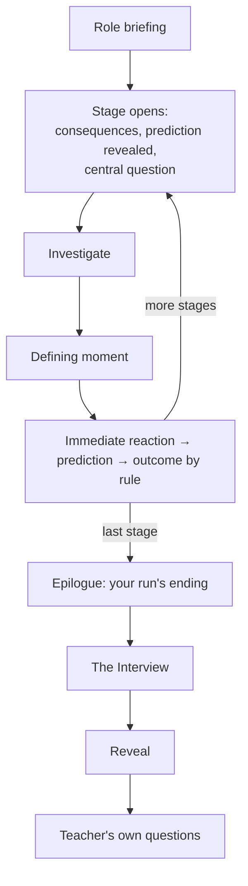
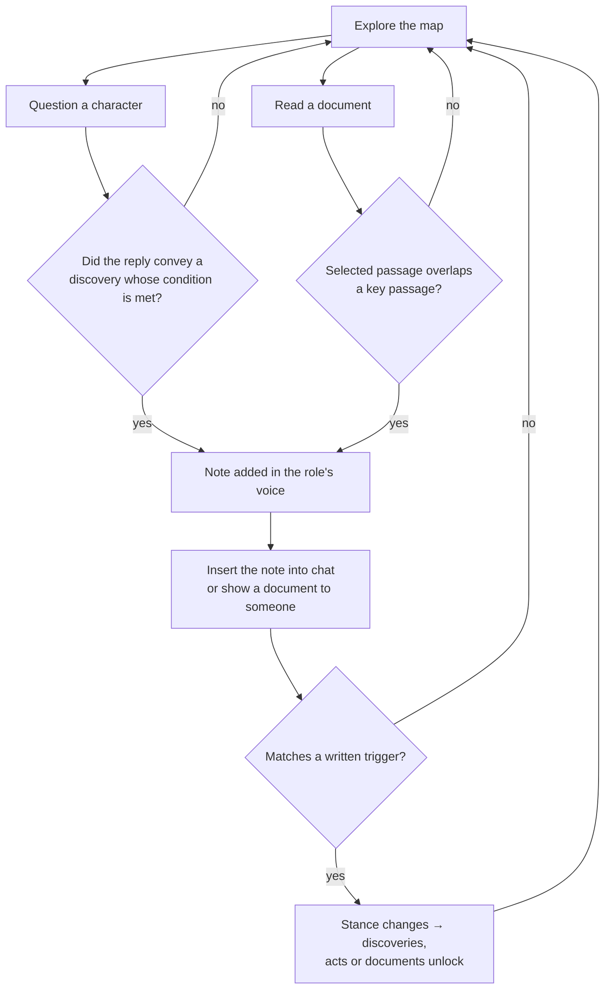
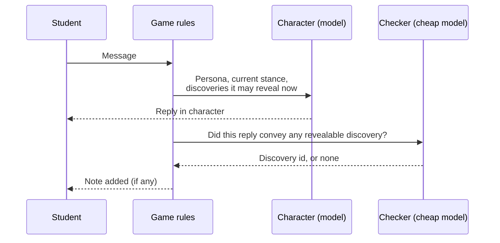
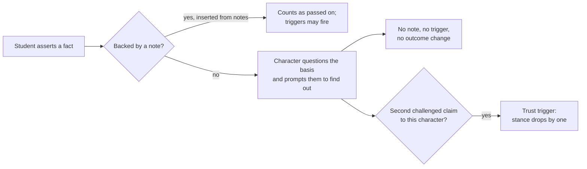
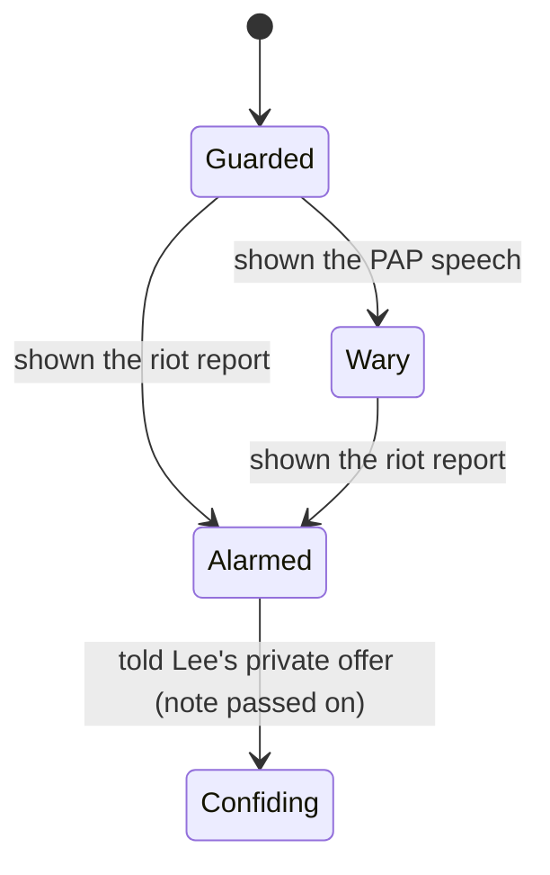
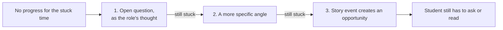
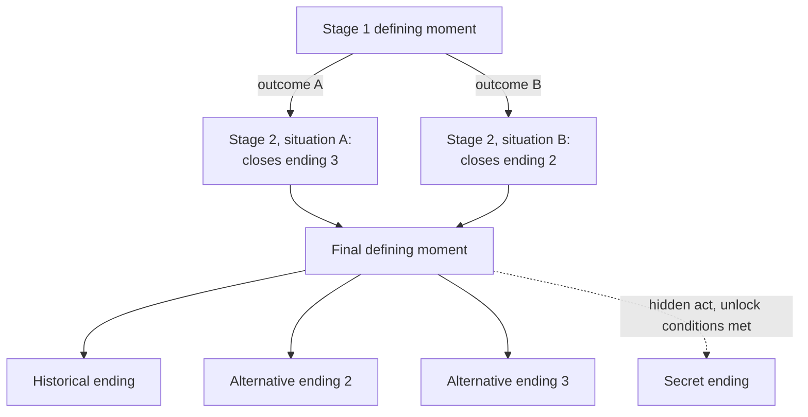

# PRD v3: Diagrams

> **Derived view, do not edit.** Generated from [`../PRD-v3.md`](../PRD-v3.md) and
> [`../PRD-v3-rationale.md`](../PRD-v3-rationale.md) as of level 5 (agreed). Mermaid diagrams render on GitHub.

## Session

## Investigating (the moment loop)

## How a reply turns into a note

## Unearned assertions

## Example stances (the Tunku)

Confiding is the hidden top stance and can unlock the secret ending.
Triggers and stance names here are illustrative; the generator writes them for each character.

## Hint escalation

## Endings across stages

There is always one stage 2; earlier outcomes change its situation and close endings rather than branching into
separate stages. At least two endings stay reachable at the end.
